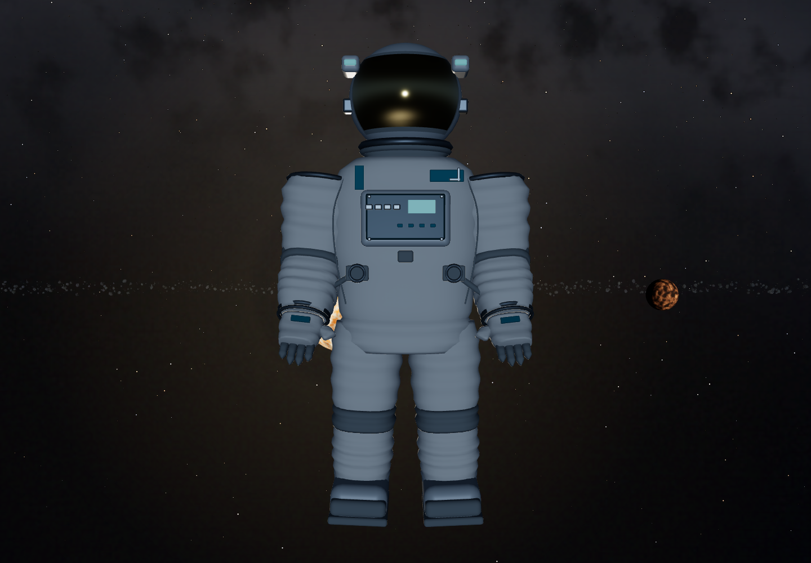
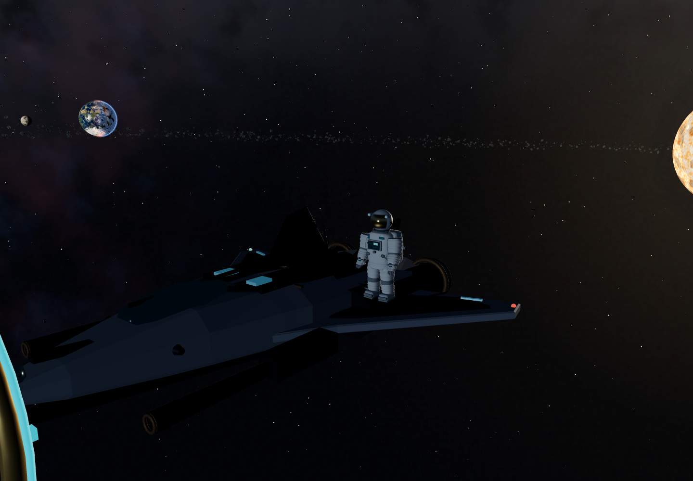
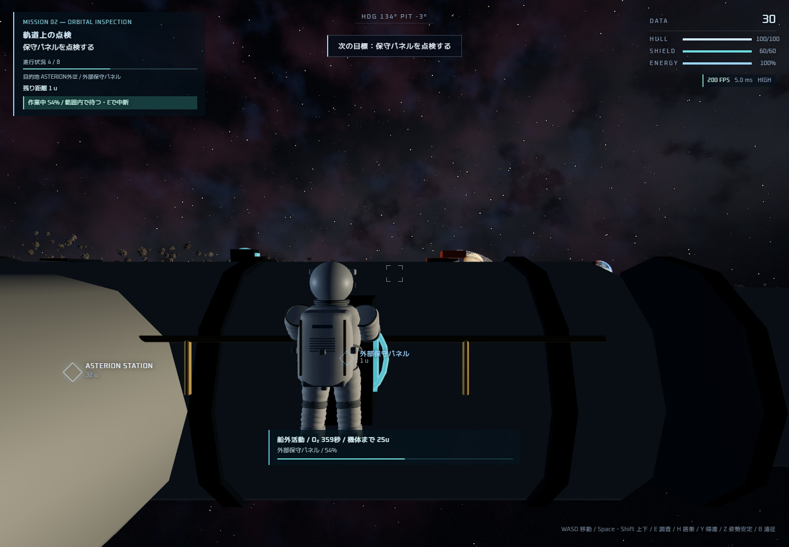

# LYRION v0.8.0 — 安定化・視覚品質の検証

2026-10-29（日本時間）。対象ソース識別子：`5d247534d06035d31d9d749b0e8c46d4fc80fb6049bf44b89807f2ddb30eddd1`。配信したゲーム、`dist/build-info.json`、作業ソースが一致することを検査しました。本番公開は行っていません。

## 発見した問題と修正

[監査記録](STABILIZATION-AUDIT.md)に、各問題の再現手順・原因・影響範囲・修正後の測定値があります。修正前の証拠も保持しています。

- 既存9件：帰還途中や誤った船の位置での瞬間搭乗、着陸降下とEVAの同時実行、離脱直後の古い接岸状態の保存、利用できない操作の無反応、壁際のカメラとブーツの貫通、壁接触での横方向慣性消失、調査済み設備が隣の修理を妨げる問題。
- 統合中3件：惑星接触による未計画の帰還開始、新スーツの背面・作業姿勢の貫通、探査機の球形判定がレコーダー作業を中断させる問題。
- 最終境界検査1件：惑星の裏側から受け付けた帰還支援が地表で停止し続ける問題。遮られる経路は開始前に理由を示して拒否し、手動操作を維持します。実行途中の通常帰還でも接触を検出したら支援を中止します。酸素・距離の緊急回収は維持します。

太陽コロナが不透明な宇宙服を透過する描画も修正しました。実ゲームでコロナの表示・非表示を比較し、胴体の120×120画素のRGB差が0であることを確認しています。スマホ通知の重なりと、EVA中に接岸を促す矛盾した案内も、撮影した画面をもとに修正しました。

## 次の行動が分かる進行

LYRION PRIMEを母星、ASTERIONを受注・補給・成果報告の拠点として表示。任務一覧と選択した任務の詳細を分け、物語・現在の目標・目的地・達成項目・報酬・クリア状況を示します。受注や報告ができない理由も表示します。

プレイ中は任務コード、目標内の進行数、目的地、実距離、現在使う操作を常時表示。実際の接岸位置・航行標・設備への誘導マーカーを使い、調査範囲内ではE／調査と作業進行を案内します。EVAでは最初に機内への帰還を案内し、古い一般的な接岸ヒントを重ねません。従来8ミッションのヒントは維持しています。

実ゲームの通常アクションで、受注→離脱→目標達成→接岸→報告→次の任務解放を確認しました。6遠征すべての指定報酬30／40／50／70／90／120 DATAと二重受け取り防止を検査しています。長距離移動や姿勢の再現にはデバッグ座標指定と固定刻みを使用し、調査・報酬・完了フラグを直接書き換えて合格扱いにはしていません。自由探査と旧8ミッションも検証しました。

## 宇宙服と実画面

人体に沿う断面をつないだオリジナルの立体裁断メッシュ、布のしわ、硬質ヘルメット、反射バイザー、金属リング、胸部コントロール、生命維持装置、ホース、グローブ、大型ブーツを実装しました。PBRの布・金属・ガラスを使い、近くの惑星からの弱い反射光を実際のゲーム照明に加えています。

EVA開始・移動・作業・帰還に応じて関節が滑らかに動き、外向きの姿勢制御噴射を表示します。新規・繰り返し使用の180姿勢で全頂点の衝突包絡を検査し、傾けた姿勢も実ゲームで確認。手動搭乗と短い帰還アニメーション、酸素切れの安全回収も検証しています。

高さ約2.06u、40,752三角形、38メッシュバッチ（非表示時も含む6噴射を含む）。細部は低画質で省略し、テクスチャを毎フレーム生成しません。外部モデル・画像配信への依存はありません。[構造・描画予算・NASA一次資料・出典](ASTRONAUT-SUIT.md)。

以下は実ゲームのモデル・照明・レンダラーから取得し、すべて目視確認しました。正面・側面・背面の検査写真だけカメラを固定しています。ステーション写真は通常のEVAカメラで、最初の任務を通常の進行条件で完了し、解放されたMISSION 02を実際に作業中です。

| 正面 | 側面 | 背面 |
|---|---|---|
| [画像](screenshots/90-astronaut-front.png) | [画像](screenshots/90-astronaut-side.png) | [画像](screenshots/90-astronaut-back.png) |

[MISSION CONTROL](screenshots/100-mission-control-focused.png)／[PCの目標HUD](screenshots/101-mission-hud-desktop.png)／[スマホ縦](screenshots/102-mission-hud-touch-390.png)／[スマホ横](screenshots/102-mission-hud-touch-800.png)／[EVA中の帰還案内](screenshots/104-brief-eva-guidance.png)。撮影中のFPS表示だけを性能比較の根拠にはしていません。

## テスト結果

| 検証 | 結果 |
|---|---|
| TypeScript／本番ビルド | 通過 |
| 単体テスト | 103／103 |
| E2E | 210／210（既存180＋監査13＋案内17） |
| 5方向の宇宙服撮影と遮蔽検査 | 通過 |
| 新規開始・母星・基地接近・接岸／解除 | 通過 |
| EVA移動・調査・帰還・一時停止・入力解除 | 通過 |
| 新6遠征・旧8ミッション・戦闘・着陸 | 通過 |
| セーブ移行・接岸復元・EVA研究の保存・報酬の重複防止 | 通過、セーブv4と保存キーを維持 |
| EVA・接岸30回 | Geometry 89→89／Texture 24→24 |
| 画質12回・敵20回の再生成 | 資源の増殖なし |
| ChromiumのPC／タッチ縦横操作 | 通過 |
| 実GPU・High・Hardで120秒連続戦闘 | 通過、20場面切替、Geometry 49→49／Texture 18→18 |
| 配布用サーバー・デバッグなし起動 | 10／10 |

[単体の生ログ](validation/stabilization-unit.json)／[13件の回帰結果](validation/stabilization-current.json)／[6遠征の通し結果](validation/homecoming.json)／[UI検証](validation/mission-clarity.json)／[モデル実測](validation/astronaut-visuals.json)。

## 実GPUでの性能

Windows、Chrome 156.0.8078.73、NVIDIA GeForce RTX 4060、WebGL 2／ANGLE／Direct3D 11。自動テスト用の他のブラウザを終了してから測定しました。Highは1920×1080、Lowは390×844の論理画面。各場面1.5秒待機後、4秒のrAFを収集し、40フレームのGPUタイマーと完了待ち時間を別に測定しています。

| 場面 | 画質 | GPU平均 ms | 描画コール |
|---|---|---:|---:|
| 通常探査 | High | 0.345 | 22 |
| 母星軌道 | High | 0.324 | 32 |
| ASTERION | High | 0.375 | 31 |
| EVA | High | 0.394 | 61 |
| 戦闘 | High | 0.360 | 25 |
| タッチ相当 | Low | 0.050 | 24 |
| タッチ相当のEVA | Low | 0.062 | 45 |

ヘッドレスのrAFは全場面約200回／秒で、フレーム間隔p95は約5.1msでした。これはモニターへ提示されたFPSとは同一ではありません。新スーツのEVA描画コールは旧44から61へ増えていますが、今回のGPU時間は1ms未満で、同じ実機条件で大幅なフレーム頻度低下は観測していません。[今回の生データと場面別比較](validation/stabilization-gpu.json)／[保持したv0.7.1基準値](validation/stabilization-gpu-baseline.json)。

連続戦闘は実時間120.97秒・20サンプルを完走し、Geometry 49／Texture 18で安定しました。再現手順と最終結果は、[集計](validation/stabilization-summary.json)と[連続動作ログ](validation/gpu-soak.json)、[起動検証](validation/launcher.json)を参照してください。

## 残っている制約・未検証

- 惑星を自動で一周する帰還経路には対応していません。遮る天体と理由を表示するので、手動で回り込み、船が見える位置からY／帰還を再実行します。手動搭乗4uと緊急回収は利用できます。
- スマホ実機、Safari／Firefox、別GPU、数時間以上の連続プレイ、音の聴感、今回の通常ウィンドウでのモニター提示FPSは未検証です。タッチ試験はこのPC上のモバイル設定Chromiumです。
- 確認した再現不具合は解消しましたが、固定刻みの座標指定テストは、すべての航路を人が手動飛行したことを意味しません。

元のダウンロードフォルダーや作業中の変更を破棄せず、この作業フォルダーで仕上げました。公開中の本番サイトの更新・mainへのマージは行っていません。
